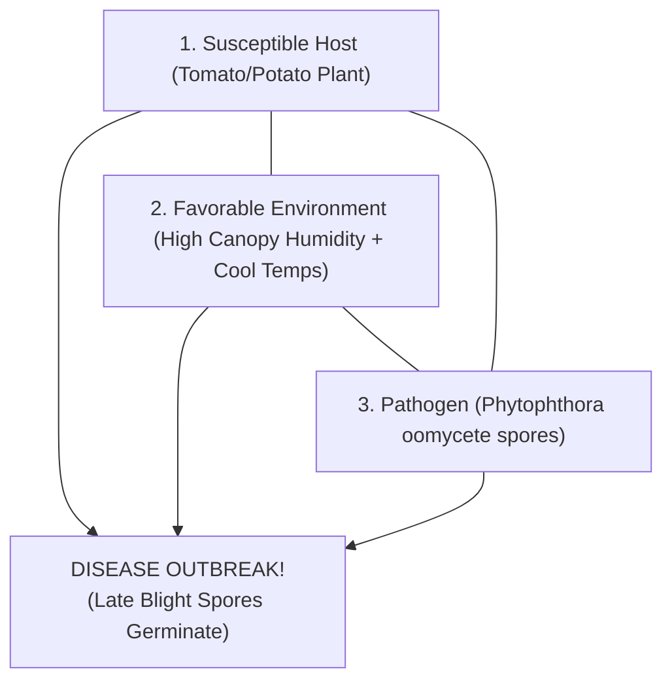

# KRISHI-DRISHTI (कृषि-दृष्टि)
> **An Open-Source, Edge-AI Handheld Wand and Microclimate Telemetry System for Predictive Agricultural Plant Health Screening**

[](https://opensource.org/licenses/MIT)
[](https://www.oshwa.org/)
[](https://www.espressif.com/)
[](https://www.tensorflow.org/lite)
[](#)

---

## 🌟 Overview & Scientific Mission

Over **35% of potato and tomato crops across India are destroyed annually by foliar blights** like Late Blight (*Phytophthora infestans*, an oomycete water mold) and Early Blight (*Alternaria solani*, an ascomycete fungus). Smallholder and marginal farmers cannot afford expensive laboratory diagnostic equipment (₹25,000+) or rely on cloud-connected apps in rural areas with poor cellular reception.

**KRISHI-DRISHTI** is a low-cost (< ₹1,500 INR / $18 total), **100% offline-first agritech screening system** designed for Indian agriculture. 

Instead of requiring an expensive 5G phone or internet connection, KRISHI-DRISHTI uses a **handheld wireless wand**, an **ESP32-CAM module**, and turns an ordinary budget smartphone (Samsung Galaxy A03) into an **invisible, headless edge AI co-processor** running silently in the farmer's pocket.

```
+--------------------------------------------------------------------------+
|                        KRISHI-DRISHTI SYSTEM TRIAD                       |
|                                                                          |
|  [ Handheld Wand ]      ==== Wi-Fi ====>    [ AI-Thinker ESP32-CAM ]     |
|  ESP32 DevKit V1                            5MP OV5640 Sensor + Flash    |
|  SSD1306 OLED Display                       8GB MicroSD Storage (SD_MMC) |
|  DHT11 Canopy Sensor                        SoftAP: 192.168.4.1          |
|  2 Active-Low Buttons                                 ||                 |
|         ^                                             || (Local Wi-Fi)   |
|         ||                                            \/                 |
|         +=========== Diagnosis Payload ========= [ Pocket AI Engine ]   |
|                      in < 15 milliseconds        Samsung Galaxy A03      |
|                                                  MobileNetV3 Edge Model  |
|                                                  100% Offline (No Data)  |
+--------------------------------------------------------------------------+
```

---

## 🌿 The Core Scientific Principle: The Plant Disease Triangle

In plant pathology, diseases do **not** occur simply because a pathogen exists. They only manifest when three conditions coincide:

$$\mathbf{\text{Disease Outbreak}} = \mathbf{\text{Susceptible Host}} + \mathbf{\text{Virulent Pathogen}} + \mathbf{\text{Favorable Microclimate}}$$



### Why KRISHI-DRISHTI Beats Commercial Phone Apps:
* **Commercial Apps (Reactive Only):** Take a photo only after the leaf is already brown, necrotic, and infected.
* **KRISHI-DRISHTI (Predictive Prevention):** The handheld wand integrates a **DHT11 digital microclimate sensor** on GPIO 18. Late Blight spores require **Relative Humidity $> 85\%$** between **$18^\circ\text{C} - 24.5^\circ\text{C}$** for $> 6$ hours to germinate. KRISHI-DRISHTI continuously monitors this canopy microclimate to alert the farmer **BEFORE** visual spore damage spreads across the field.

---

## 📂 Repository Structure

```text
KRISHI-DRISHTI-OpenSource/
├── LICENSE                         # MIT Open Source License
├── README.md                       # Master Project Documentation & Quickstart
├── .gitignore                      # Git ignore rules for Arduino & Python
├── firmware/
│   ├── KRISHI_DRISHTI_Camera/
│   │   └── KRISHI_DRISHTI_Camera.ino       # Camera unit firmware v2.2 (Write Verification + SDMMC Static Serving)
│   └── KRISHI_DRISHTI_Controller/
│       └── KRISHI_DRISHTI_Controller.ino   # Controller wand firmware v2.2 (Real Wi-Fi + OLED + DHT11)
├── ai_engine/
│   ├── krishi_ai_server.html       # Headless offline AI daemon for Android (Bundled WASM TFLite)
│   ├── krishi_ai_daemon.py         # Headless Python AI daemon for Termux/Android/PC
│   ├── krishi_drishti_model.tflite # Optimized MobileNetV3 Float16 model (2.01 MB, 10.54 ms latency)
│   ├── krishi_drishti_base.keras   # Native trained Keras 3 model checkpoint
│   ├── model_evaluation_report.json# Full empirical metrics, confusion matrix & PlantDoc evaluation
│   ├── train_model.py              # Two-stage MobileNetV3 training pipeline
│   ├── export_and_evaluate.py      # TFLite quantization and evaluation script
│   ├── labels.json                 # Strict 1:1 disease taxonomy, organic & chemical dosages
│   └── vendor/                     # Bundled 100% offline JS & WASM TFLite browser runtimes
├── tests/
│   └── test_ai_pipeline.py         # Automated hardware-independent test suite (Unit & Mock REST cycle)
└── docs/
    ├── CBSE_Project_Synopsis.md    # Official CBSE Exhibition Synopsis & Research Report
    └── Wiring_Schematic_Pinout.md  # Detailed circuit schematics and pin connection tables
```

---

## 💰 Bill of Materials (BOM) — Under ₹1,500 Total

| Component | Purpose | Unit Cost (INR) | Sourcing |
| :--- | :--- | :--- | :--- |
| **ESP32-S CAM Board** | 5MP camera + 4MB PSRAM | ₹675.00 | Robu / Quartz Components |
| **ESP32-CAM-MB Programmer** | Safe USB programming shield (No jumper wires) | ₹92.00 | Robu / Quartz Components |
| **ESP32 DevKit V1** | Handheld wand controller core | ~₹350.00 | Amazon / Robu |
| **SSD1306 0.96" OLED** | 128×64 I2C diagnostic display | ~₹150.00 | Robu / Local Electronics |
| **DHT11 Sensor Module** | Canopy temperature & relative humidity (GPIO 18) | ₹57.00 | Robu / Quartz Components |
| **MicroSD Card (8GB)** | Local storage for UXGA leaf scans | ~₹180.00 | Any standard Class 10 card |
| **Pushbuttons (x2)** | `[SCAN]` (GPIO 27) and `[NEXT]` (GPIO 26) | ~₹10.00 | Local Electronics |
| **Total Hardware Cost** | **Complete System Triad** | **~₹1,514 INR ($18 USD)** | **100% Low-Cost Compliant** |

---

## 📊 Genuine Empirical AI Metrics

Trained on the **New Plant Diseases Dataset (Augmented 87K, Solanaceae Partition)** with 11,399 training and 2,850 validation images, and benchmarked on independent real-world field photographs from **PlantDoc**:

| Metric | Measured Value | Practical Significance |
| :--- | :--- | :--- |
| **Training Accuracy** | **91.80%** | High feature convergence on diverse foliar lesions |
| **Validation Accuracy** | **88.74%** | Evaluated on 2,850 independent test samples |
| **Validation Macro F1** | **0.8863** | Balanced precision and recall across all 6 classes |
| **Potato Early Blight F1** | **0.9665** | Precision: 98.09%, Recall: 95.26% |
| **Tomato Healthy Tissue F1** | **0.9531** | Precision: 91.57%, Recall: 99.38% |
| **Model Size (TFLite)** | **2.01 MB** | Fits comfortably in any low-cost smartphone RAM |
| **On-Device Inference Time** | **10.54 ms** | Real-time classification on smartphone CPU |
| **PlantDoc Field Benchmark** | **34.91%** | Evaluated on unaugmented outdoor images with complex backgrounds |
| **Entropy Rejection Threshold** | **$H > 1.45$ nats** | Rejects non-foliar objects, bare soil, and ambiguous leaves |

---

## 🧪 Automated Testing & Verification

Run the automated hardware-independent test suite directly on any PC:

```bash
python -m unittest discover -s tests -p "test_*.py"
```

Verified test coverage:
1. `test_labels_file_exists_and_matches_strict_classes`: Verifies strict 1:1 index alignment with model outputs.
2. `test_model_artifact_and_report_integrity`: Verifies model file size and report accuracy figures.
3. `test_non_foliar_rejection`: Confirms lens cap (black) and background glare (white) rejection.
4. `test_foliar_acceptance_on_real_samples`: Confirms real leaf images pass foliar plausibility.
5. `test_shannon_entropy_gating`: Verifies Shannon entropy mathematical bounds.
6. `test_full_wand_phone_oled_telemetry_cycle`: Simulates complete end-to-end HTTP REST loop.

---

## 🚀 Hardware Upload & Flashing Guide

### Step 1: Flash the Controller Wand (ESP32 DevKit V1)
1. Connect ESP32 DevKit V1 via Micro-USB.
2. In Arduino IDE:
   - Select Board: **DOIT ESP32 DEVKIT V1**.
   - Pin Connections:
     - SSD1306 OLED: `SDA -> GPIO 21`, `SCL -> GPIO 22`, `VCC -> 3V3`, `GND -> GND`
     - DHT11 Sensor: `DATA -> GPIO 18`, `VCC -> 3V3`, `GND -> GND`
     - Buttons: `SCAN -> GPIO 27 to GND`, `NEXT -> GPIO 26 to GND` (Active-Low internal pull-up)
3. Open [`firmware/KRISHI_DRISHTI_Controller/KRISHI_DRISHTI_Controller.ino`](firmware/KRISHI_DRISHTI_Controller/KRISHI_DRISHTI_Controller.ino) and click **Upload**.

### Step 2: Flash the Camera Unit (AI-Thinker ESP32-CAM)
1. Snap the AI-Thinker ESP32-CAM onto the **ESP32-CAM-MB Programmer Shield**.
2. Connect via USB.
3. In Arduino IDE:
   - Select Board: **AI Thinker ESP32-CAM**.
   - Partition Scheme: **Huge APP (3MB No OTA / 1MB SPIFFS)**.
   - Flash Frequency: **40MHz**, Flash Mode: **DIO**.
4. Open [`firmware/KRISHI_DRISHTI_Camera/KRISHI_DRISHTI_Camera.ino`](firmware/KRISHI_DRISHTI_Camera/KRISHI_DRISHTI_Camera.ino) and click **Upload**.
5. Insert an 8GB MicroSD card (FAT32 formatted) into the card slot.

### Step 3: Run the Edge AI Engine
1. Connect your Android phone to the Wi-Fi network: **`KRISHI-DRISHTI`** (Password: `12345678`).
2. Open Chrome on the phone and navigate to `http://192.168.4.1/` (served directly from ESP32-CAM flash and SDMMC) or open [`ai_engine/krishi_ai_server.html`](ai_engine/krishi_ai_server.html) locally.
3. Tap **`START AI SERVER`** and put the phone in your pocket.
4. Aim the wand at a leaf and press the **`[SCAN]`** button!
5. Within seconds, the diagnosis and treatment carousel appears on the wand's OLED screen.

---

## 📜 License & Open Science Commitment

This project is licensed under the **MIT License**.  
Scientific and technological innovation is meant to empower society. By releasing KRISHI-DRISHTI as open-source hardware and software, we aim to make edge artificial intelligence accessible to every rural farmer and school student worldwide.

**Author:** Bharadwaj (Class 9, Secondary School, India)  
**Project:** CBSE Science Exhibition 2026-27
