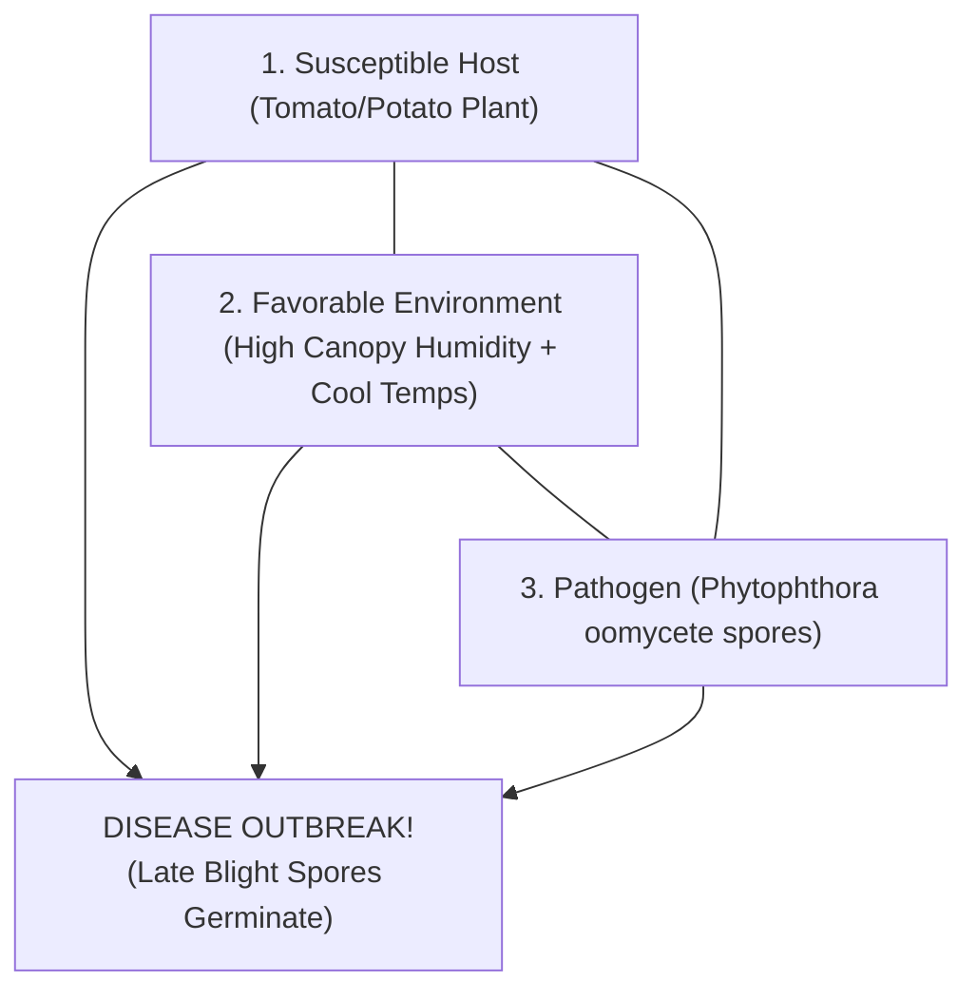

# KRISHI-DRISHTI (कृषि-दृष्टि)
> **Offline-First Edge-AI Handheld Wand and Microclimate Telemetry System for Predictive Agricultural Plant Health Screening**
>
> 🌿 **Agritech Edge-AI & IoT Diagnostic Framework**  
> 🎯 **Focus:** *Affordable, Offline-First Precision Plant Pathology for Smallholder Farmers*  
> 💡 **Core Stack:** ESP32-CAM | TensorFlow Lite | FreeRTOS | Mobile Edge Computing

[](LICENSE)
[](https://www.espressif.com/)
[](https://www.tensorflow.org/lite)
[](#)

---

## 🌟 Overview & System Architecture

Over **35% of potato and tomato crops across India are destroyed annually by foliar blights** like Late Blight (*Phytophthora infestans*, an oomycete water mold) and Early Blight (*Alternaria solani*, an ascomycete fungus). Smallholder and marginal farmers often lack access to expensive laboratory diagnostic equipment (₹25,000+) or reliable cloud connectivity in rural fields with poor cellular reception.

**KRISHI-DRISHTI** is an ultra-low-cost (₹1,480 INR / $18 USD total), **100% offline-first agritech screening system** designed for rural field environments.

Instead of relying on cloud APIs or expensive 5G connectivity, KRISHI-DRISHTI uses a **handheld wireless telemetry wand**, an **ESP32-CAM optical capture unit**, and **any standard smartphone (Android or iOS / iPhone / any brand)** acting as a universal, **browser-based edge AI co-processor** operating over a dedicated local Wi-Fi network. Zero apps or APKs to install — it runs entirely in the browser via offline WebAssembly.

```
+--------------------------------------------------------------------------+
|                        KRISHI-DRISHTI SYSTEM TRIAD                       |
|                                                                          |
|  [ Handheld Wand ]      ==== Wi-Fi ====>    [ AI-Thinker ESP32-CAM ]     |
|  ESP32 DevKit V1                            OV2640 / OV5640 Sensor+Flash |
|  SSD1306 OLED Display                       8GB MicroSD Storage (SD_MMC) |
|  DHT11 Canopy Sensor                        SoftAP: 192.168.4.1          |
|  1 Active-Low Button (GPIO 27)                        ||                 |
|         ^                                             || (Local Wi-Fi)   |
|         ||                                            \/                 |
|         +=========== Diagnosis Payload ========= [ Pocket AI Engine ]   |
|                      synced via local HTTP mesh      Any Phone (Android) |
|                      (1s poll, <15ms payload)        MobileNetV3 WASM/py |
|                                                      100% Offline        |
+--------------------------------------------------------------------------+
```

---

## 🌿 The Core Scientific Principle: The Plant Disease Triangle

In plant pathology, diseases do **not** occur simply because a pathogen exists. They only manifest when three conditions coincide:

$$\mathbf{\text{Disease Outbreak}} = \mathbf{\text{Susceptible Host}} + \mathbf{\text{Virulent Pathogen}} + \mathbf{\text{Favorable Microclimate}}$$



### Proactive Microclimate Correlation vs. Reactive Classification:
* **Reactive Classification:** Evaluates leaves only after severe necrosis, chlorosis, and irreversible tissue decay have occurred.
* **KRISHI-DRISHTI Predictive Triage:** The handheld wand integrates a **DHT11 digital microclimate sensor** on GPIO 18. It tracks the microclimatic incubation conditions (ambient temperature and relative humidity) that create the thermodynamic envelope for *Phytophthora infestans* sporulation and infection (Relative Humidity $> 85\%$ between $18^\circ\text{C} - 24.5^\circ\text{C}$ for $> 6$ continuous or accumulated risk hours, following the Wallin/Hyre disease forecast model). Note: The sensor monitors favorable atmospheric incubation conditions, not microscopic airborne fungal spores or surface leaf wetness film directly.

---

## 📂 Repository Structure

```text
KRISHI-DRISHTI/
├── LICENSE                         # Source-Available Non-Commercial License
├── README.md                       # Master Project Architecture & Guide
├── .gitignore                      # Git ignore rules for Arduino & Python
├── firmware/
│   ├── KRISHI_DRISHTI_Camera/
│   │   └── KRISHI_DRISHTI_Camera.ino       # Camera unit firmware v2.5.1 (SDMMC + Static Serving)
│   └── KRISHI_DRISHTI_Controller/
│       ├── KRISHI_DRISHTI_Controller.ino   # Controller wand firmware v2.5.1 (Wi-Fi + OLED + DHT11)
│       ├── MicroclimateTracker.h           # Canopy risk epidemiology tracker
│       └── MicroclimateTracker.cpp         # Accumulated microclimate hours state machine
├── ai_engine/
│   ├── krishi_drishti_model.tflite # Float16 Quantized MobileNetV3-Small (2.03 MB, Float32 I/O)
│   ├── krishi_ai_server.html       # Offline browser AI engine & live telemetry dashboard
│   ├── krishi_ai_daemon.py         # Standalone headless edge Python daemon
│   ├── model_evaluation_report.json# Full empirical metrics, confusion matrix & PlantDoc evaluation
│   ├── labels.json                 # Strict 1:1 disease taxonomy, organic & chemical dosages
│   ├── sample_leaves/              # Canonical macro foliar targets & non-foliar edge controls
│   ├── validation_60_specimens/    # Bundled 60-specimen ground-truth dataset (10 per class)
│   └── vendor/                     # Bundled 100% offline JS & WASM TFLite browser runtimes
├── tests/
│   ├── test_ai_pipeline.py         # Automated hardware-independent test suite (13 Unit & Integration tests)
│   ├── test_microclimate_tracker.cpp# Native C++ unit test harness (-Wall -Wextra -Werror compliant)
│   ├── verify_tflite_model.py      # Production daemon inference & gating verification audit
│   ├── benchmark_60_specimens.py   # Reproducible 60-specimen botanical validation benchmark
│   ├── run_all_tests.py            # Master cross-platform test runner
│   ├── benchmark_60_specimens_report.json # Full 60-specimen empirical benchmark results
│   └── tflite_model_verification_audit.json # Cryptographic audit log (SHA-256, tensor shapes, latencies)
├── Flash_ESP32_CAM.bat             # 1-Click flasher for ESP32-CAM
├── Flash_ESP32_Controller.bat      # 1-Click flasher for ESP32 Controller
├── Start_AI_Server.bat             # Local server launcher for browser AI engine
└── docs/
    ├── System_Architecture_Report.md# In-depth architectural & pathological specification
    ├── Wiring_Schematic_Pinout.md  # Detailed circuit schematics and pin connection tables
    └── Repeatability_Test_Protocol.md # 50-condition physical repeatability protocol
```

---

## 💰 Bill of Materials (BOM) — Field Prototype (₹1,480 Total)

| Component | Purpose | Unit Cost (INR) | Sourcing |
| :--- | :--- | :--- | :--- |
| **ESP32-S CAM Board** | 5MP camera + 4MB PSRAM | ₹646.00 | Standard Electronics Distributor |
| **ESP32-CAM-MB Programmer** | USB programming shield (No jumper wires) | ₹92.00 | Standard Electronics Distributor |
| **ESP32 DevKit V1** | Handheld wand controller core | ~₹350.00 | Standard Electronics Distributor |
| **SSD1306 0.96" OLED** | 128×64 I2C diagnostic display | ~₹150.00 | Local Electronics |
| **DHT11 Sensor Module** | Canopy temperature & relative humidity (GPIO 18) | ₹57.00 | Standard Electronics Distributor |
| **MicroSD Card (8GB)** | Local storage for UXGA leaf scans | ~₹175.00 | Standard Class 10 card |
| **Pushbutton (x1)** | Multifunction `[SCAN/PAGE]` on GPIO 27 | ~₹5.00 | Local Electronics |
| **Total Hardware Cost** | **Complete System Triad** | **₹1,480 INR ($18 USD)** | **Ultra-Low Cost Compliant** |

---

## 📊 Measured Empirical Metrics

Trained on the **Dual-Domain Pure Solanaceae Corpus** (7,710 total training records representing 6,965 unique image files: 6,600 clean PlantVillage samples [1,100/class] strictly filtered for zero exact and perceptual overlap, plus 1,110 clean outdoor PlantDoc representations [370 unique images replicated 3x]; fully documented in `ai_engine/TRAINING_RUN_MANIFEST.json`), and benchmarked on independent real-world field photographs from **PlantDoc** and the 60-specimen botanical benchmark:

| Metric | Measured Value | Practical Significance |
| :--- | :--- | :--- |
| **Validation Set Accuracy** | **88.74%** | 2,529 / 2,850 held-out validation images (`ai_engine/model_evaluation_report.json`) |
| **Validation Macro F1** | **0.8863** | Unweighted mean of the six per-class F1 scores below |
| **Tomato Late Blight** | P 92.15% / R 65.87% / **F1 0.7683** | Weakest class: about a third of late-blight tissue is predicted as potato late blight |
| **Tomato Early Blight** | P 94.96% / R 74.58% / **F1 0.8355** | Confused mainly with tomato late blight and healthy tissue |
| **Tomato Healthy** | P 91.57% / R 99.38% / **F1 0.9531** | Very high recall; 20 healthy frames offered to blight classes |
| **Potato Late Blight** | P 68.92% / R 98.76% / **F1 0.8119** | High recall, low precision: absorbs tomato late-blight frames |
| **Potato Early Blight** | P 98.09% / R 95.26% / **F1 0.9665** | Most reliable blight class |
| **Potato Healthy** | P 98.46% / R 98.03% / **F1 0.9824** | Most reliable class overall |
| **Model Size (TFLite)** | **2.03 MB** (2,123,856 bytes) | Float16 post-training weights with Float32 I/O interfaces |
| **Inference Latency** | **5.57 ms mean (host PC CPU reference)** | 60-specimen benchmark on an Intel Core i5 with XNNPACK (`tests/benchmark_60_specimens_report.json`); mobile-edge latency has not been measured on device; wand sync < 15 ms |
| **60-Specimen Botanical Benchmark** | **95.00% Strict / 98.28% Accepted** | 57/60 strict 6-class match; 57/58 accepted-frame accuracy (96.67% coverage, 2 frames gated UNCERTAIN); pathogen-family match 57/60 |
| **PlantDoc Outdoor Benchmark** | **22.58% Raw / 60.00% Accepted (Held-Out)** | 93 genuinely unseen images (hash-excluded from training): 21/93 raw; 21/35 accepted, 58 gated UNCERTAIN. Full adaptation corpus (487 images): 32.44% raw (158/487) / 73.49% accepted (158/215) — `tests/plantdoc_benchmark_audit.json` |
| **Entropy Rejection Threshold** | **$H > 1.45$ nats** | Rejects non-foliar objects, bare soil, and ambiguous leaves |

*Source of each figure:* validation accuracy and per-class scores come from the training run recorded in `ai_engine/model_evaluation_report.json`; the 60-specimen and PlantDoc figures are re-measured against the currently shipped `ai_engine/krishi_drishti_model.tflite` (SHA-256 `a2a4c9f6…`) in `tests/benchmark_60_specimens_report.json` and `tests/plantdoc_benchmark_audit.json`.

### 🔬 Core Scientific Principles & Real-World Edge Nuances:
1. **Pathogen Match $\\neq$ Exact Classification:** *Phytophthora infestans* incites Late Blight in both Tomato and Potato. When a tomato late blight leaf is predicted as potato late blight, the biological pathogen family matches, but the discrete 6-class prediction is incorrect. Exact 6-class accuracy (57/60 = 95.00%) is reported separately from pathogen correlation (57/60). The per-class table above is the honest view: late blight recall is substantially lower than the aggregate figure suggests.
2. **Optical Shroud as an Image Acquisition Mechanism:** The 3D-printed 8–10 cm cylindrical shroud stabilizes macro focal distance and suppresses oblique shadows, but it does **not** serve as an out-of-distribution biological filter. Non-crop alien leaves (e.g., tea foliage) can still satisfy foliar ratio checks and require multi-modal uncertainty gating.
3. **Microclimate Advisory vs. Proof of Absence:** The DHT11 telemetry provides a simplified environmental risk advisory (based on Wallin / Hyre microclimate principles). An instantaneous $\\text{RH} < 85\%$ suppresses unneeded chemical sprays, but does not biologically prove pathogen absence.
4. **Physical Field Validation Milestone:** The ultimate benchmark of KRISHI-DRISHTI is testing on images captured directly by the ESP32-CAM OV5640 wand in local agricultural plots (protocol defined in `tests/hardware_field_captures/FIELD_VALIDATION_PROTOCOL.md`).

---

## 🧪 Automated Testing & Verification

### Command-Line Execution:
```bash
# 1. Master cross-platform test runner (all 6 verification suites)
python tests/run_all_tests.py

# 2. Python automated unit & integration suite (13 tests)
python -m unittest discover -s tests -p "test_*.py"

# 3. Production daemon 10-specimen & gating verification audit
python tests/verify_tflite_model.py

# 4. Reproducible 60-specimen botanical benchmark (10 per class)
python tests/benchmark_60_specimens.py

# 5. Native C++ MicroclimateTracker firmware unit tests (Zero-warning compilation)
g++ -Wall -Wextra -Werror -std=c++11 tests/test_microclimate_tracker.cpp firmware/KRISHI_DRISHTI_Controller/MicroclimateTracker.cpp -o test_tracker && ./test_tracker
```

### Verified Test Coverage (13 tests in `tests/test_ai_pipeline.py`):
1. `test_labels_file_exists_and_matches_strict_classes`: Strict 1:1 index alignment with the 6 Solanaceae disease classes.
2. `test_model_artifact_and_report_integrity`: Verifies TFLite model presence (>1 MB) and genuine validation metrics.
3. `test_non_foliar_rejection`: Mathematical rejection of lens caps (all-black), walls (all-white), and noise.
4. `test_foliar_acceptance_on_real_samples`: Confirms genuine tomato and potato leaf samples pass foliar gating.
5. `test_shannon_entropy_gating`: Epistemic uncertainty validation ($H > 1.45$ nats rejects uniform/ambiguous logits).
6. `test_full_wand_phone_oled_telemetry_cycle`: End-to-end hardware-in-the-loop HTTP REST simulation.
7. `test_stale_scan_id_is_rejected`: HTTP 409 Conflict rejection for out-of-sequence or outdated diagnosis submissions.
8. `test_tflite_input_contract_and_softmax_sum`: Allocates tensors, verifies raw `[0, 255]` float32 input, and checks softmax $\sum P_i = 1.0$.
9. `test_controller_timeout_race_protection`: Ensures diagnoses arriving at the 14-second boundary are never overwritten by timeout handlers.
10. `test_firmware_microclimate_tracker_cpp_module`: Compiles and executes native C++ `MicroclimateTracker` test harness or verifies state transitions, drying decay (2x rate), and sensor disconnection.
11. `test_daemon_quantization_branches_uint8_and_int8`: Calls production `KrishiAIDaemon.preprocess_image` to verify `uint8` [0, 255], `int8` [-128, 127], and `float32` contracts.
12. `test_end_to_end_rest_telemetry_pipeline_and_stale_cache_reset`: Full capture → inference → OLED payload round-trip with stale cache reset.
13. `test_microclimate_cross_gating_suppresses_false_fungicide_alert`: Confirms a low-humidity reading suppresses an unneeded blight fungicide advisory.

---

## 🚀 Hardware Upload & Flashing Guide

### Step 1: Flash the Controller Wand (ESP32 DevKit V1)
1. Connect ESP32 DevKit V1 via Micro-USB.
2. In Arduino IDE:
   - Select Board: **DOIT ESP32 DEVKIT V1**.
   - Pin Connections:
     - SSD1306 OLED: `SDA -> GPIO 21`, `SCL -> GPIO 22`, `VCC -> 3V3`, `GND -> GND`
     - DHT11 Sensor: `DATA -> GPIO 18`, `VCC -> 3V3`, `GND -> GND`
     - Button: `GPIO 27 to GND` (Active-Low internal pull-up, Tap = Next/Scan, Hold = Force Scan)
3. Open [`firmware/KRISHI_DRISHTI_Controller/KRISHI_DRISHTI_Controller.ino`](firmware/KRISHI_DRISHTI_Controller/KRISHI_DRISHTI_Controller.ino) and click **Upload**.

### Step 2: Flash the Camera Unit (AI-Thinker ESP32-CAM)
1. Snap the AI-Thinker ESP32-CAM onto the **ESP32-CAM-MB Programmer Shield**.
2. Connect via USB.
3. In Arduino IDE:
   - Select Board: **AI Thinker ESP32-CAM**.
   - Partition Scheme: **Huge APP (3MB No OTA / 1MB SPIFFS)**.
   - Flash Frequency: **40MHz**, Flash Mode: **DIO**.
4. Open [`firmware/KRISHI_DRISHTI_Camera/KRISHI_DRISHTI_Camera.ino`](firmware/KRISHI_DRISHTI_Camera/KRISHI_DRISHTI_Camera.ino) and click **Upload**.
5. Insert the prepared 8GB MicroSD card (FAT32 formatted) into the card slot.

### Step 3: Run the Edge AI Engine
1. Connect your Android phone to the Wi-Fi network: **`KRISHI-DRISHTI`** (Password: `12345678`).
2. Open Chrome on the phone and navigate to `http://192.168.4.1/` (served directly from ESP32-CAM flash and SDMMC) or open [`ai_engine/krishi_ai_server.html`](ai_engine/krishi_ai_server.html) locally.
3. Tap **`START AI SERVER`** and place the phone in your pocket.
4. Aim the wand at a leaf and press the **`[SCAN]`** button!
5. Within seconds, the diagnosis and treatment carousel appears on the wand's OLED screen.

---

## 🛠 Troubleshooting

### Controller Wand Not Connecting to Camera SoftAP
If the controller boots but shows "Searching CAM" or "ESP32-CAM Not Linked":

1. **Verify the camera SoftAP is broadcasting** — The ESP32-CAM must be powered on and broadcasting `KRISHI-DRISHTI` Wi-Fi before the controller boots.
2. **Controller port** — Flash the controller to your actual port (e.g. `COM5`):
   ```
   .\Flash_ESP32_Controller.bat COM5
   ```
3. **Static IP** — The controller is hardcoded to `192.168.4.2` and the camera gateway is `192.168.4.1`. `WiFi.config()` is applied in `setup()` and on every reconnect attempt (`ensureWiFiConnected()`).
4. **Signal range** — Keep the controller within ~5 meters of the camera wand. ESP32 TX power is capped at 8.5 dBm to prevent USB brownout.

### OLED Display Dimming / Flickering Randomly
The controller previously called `display.dim(true)` which set the SSD1306 to low-contrast mode. This has been changed to `display.dim(false)` for consistent full brightness. If you still see flicker:

1. **Check power supply** — USB power dips during Wi-Fi radio activity can cause the OLED to appear to dim. Use a quality USB cable and power source.
2. **Brownout disabled** — `WRITE_PERI_REG(RTC_CNTL_BROWN_OUT_REG, 0)` is set in `setup()` to prevent brownout resets during Wi-Fi PLL lock.

### Flashing
- Camera Wand (AI-Thinker ESP32-CAM): `.\Flash_ESP32_CAM.bat COM7`
- Controller Wand (ESP32 DevKit V1): `.\Flash_ESP32_Controller.bat COM5` (or your actual port)

This project is licensed under the **Source-Available Non-Commercial License**. See [`LICENSE`](LICENSE) for terms.  
Source code, schematics, and model weights are made available solely for personal inspection, educational evaluation, and non-commercial research. Commercial manufacturing, sublicensing, redistribution, and third-party patent filing without explicit written authorization are strictly prohibited.

**Author & Systems Designer:** Gautam Kumar  
**Copyright (c) 2026 Gautam Kumar. All rights reserved.**
