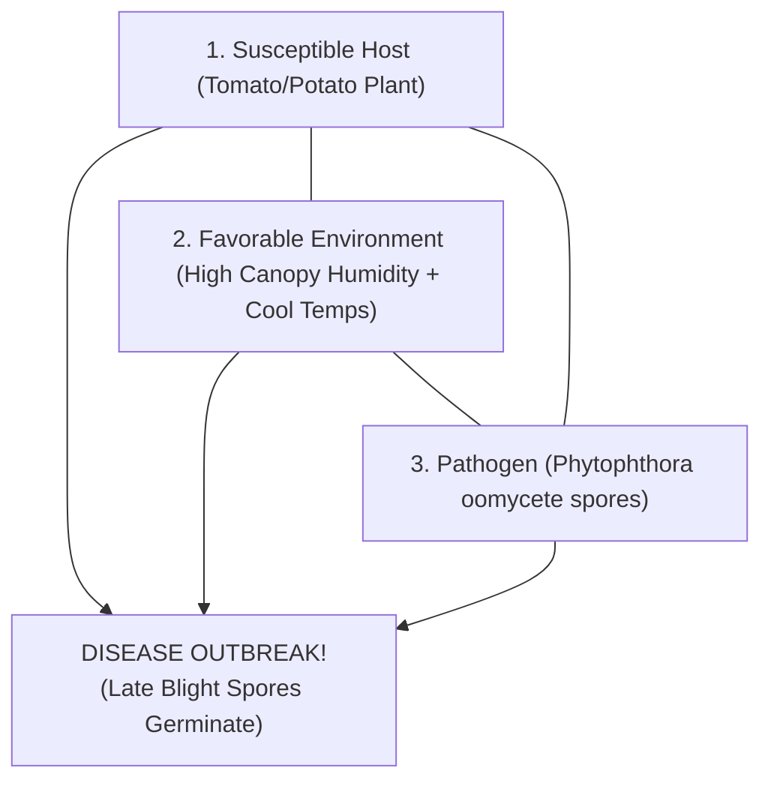

# KRISHI-DRISHTI (कृषि-दृष्टि)
> **Offline-First Edge-AI Handheld Wand and Microclimate Telemetry System for Predictive Agricultural Plant Health Screening**
>
> 🏆 **54th National Children's Science Congress (NCSC 2026)**  
> 🌍 **Focal Theme:** *Science and Innovation for Sustainability*  
> 📍 **Evaluation:** District Level Evaluation Round | B.S.S. Collegiate +2 High School, Begusarai, Bihar

[](LICENSE)
[](https://www.espressif.com/)
[](https://www.tensorflow.org/lite)
[](#)

---

## 🌟 Overview & System Architecture

Over **35% of potato and tomato crops across India are destroyed annually by foliar blights** like Late Blight (*Phytophthora infestans*, an oomycete water mold) and Early Blight (*Alternaria solani*, an ascomycete fungus). Smallholder and marginal farmers often lack access to expensive laboratory diagnostic equipment (₹25,000+) or reliable cloud connectivity in rural fields with poor cellular reception.

**KRISHI-DRISHTI** is an ultra-low-cost (~₹1,514 INR / $18 USD total), **100% offline-first agritech screening system** designed for rural field environments.

Instead of relying on cloud APIs or expensive 5G connectivity, KRISHI-DRISHTI uses a **handheld wireless telemetry wand**, an **ESP32-CAM optical capture unit**, and an ordinary budget smartphone (e.g. Samsung Galaxy A03) acting as an **invisible, headless edge AI co-processor** operating over a dedicated local Wi-Fi mesh.

```
+--------------------------------------------------------------------------+
|                        KRISHI-DRISHTI SYSTEM TRIAD                       |
|                                                                          |
|  [ Handheld Wand ]      ==== Wi-Fi ====>    [ AI-Thinker ESP32-CAM ]     |
|  ESP32 DevKit V1                            5MP OV5640 Sensor + Flash    |
|  SSD1306 OLED Display                       8GB MicroSD Storage (SD_MMC) |
|  DHT11 Canopy Sensor                        SoftAP: 192.168.4.1          |
|  2 Active-Low Buttons                                 ||                 |
|         ^                                             || (Local Wi-Fi)   |
|         ||                                            \/                 |
|         +=========== Diagnosis Payload ========= [ Pocket AI Engine ]   |
|                      synced in < 15 ms           Samsung Galaxy A03      |
|                                                  MobileNetV3 Edge Model  |
|                                                  100% Offline (No Data)  |
+--------------------------------------------------------------------------+
```

---

## 🌿 The Core Scientific Principle: The Plant Disease Triangle

In plant pathology, diseases do **not** occur simply because a pathogen exists. They only manifest when three conditions coincide:

$$\mathbf{\text{Disease Outbreak}} = \mathbf{\text{Susceptible Host}} + \mathbf{\text{Virulent Pathogen}} + \mathbf{\text{Favorable Microclimate}}$$



### Proactive Microclimate Correlation vs. Reactive Classification:
* **Reactive Classification:** Evaluates leaves only after severe necrosis, chlorosis, and irreversible tissue decay have occurred.
* **KRISHI-DRISHTI Predictive Triage:** The handheld wand integrates a **DHT11 digital microclimate sensor** on GPIO 18. It tracks the microclimatic incubation conditions (ambient temperature and relative humidity) that create the thermodynamic envelope for *Phytophthora infestans* sporulation and infection (Relative Humidity $> 85\%$ between $18^\circ\text{C} - 24.5^\circ\text{C}$ for $> 6$ continuous or accumulated risk hours, following the Wallin/Hyre disease forecast model). Note: The sensor monitors favorable atmospheric incubation conditions, not microscopic airborne fungal spores or surface leaf wetness film directly.

---

## 📂 Repository Structure

```text
KRISHI-DRISHTI/
├── LICENSE                         # Source-Available Non-Commercial License
├── README.md                       # Master Project Architecture & Guide
├── .gitignore                      # Git ignore rules for Arduino & Python
├── firmware/
│   ├── KRISHI_DRISHTI_Camera/
│   │   └── KRISHI_DRISHTI_Camera.ino       # Camera unit firmware v2.2 (Write Verification + SDMMC Static Serving)
│   └── KRISHI_DRISHTI_Controller/
│       └── KRISHI_DRISHTI_Controller.ino   # Controller wand firmware v2.2 (Real Wi-Fi + OLED + DHT11)
├── ai_engine/
│   ├── krishi_drishti_model.tflite # Float16 Quantized MobileNetV3-Small (2.01 MB, Float32 I/O)
│   ├── krishi_ai_server.html       # Offline browser AI engine & live telemetry dashboard
│   ├── krishi_ai_daemon.py         # Standalone headless edge Python daemon
│   ├── model_evaluation_report.json# Full empirical metrics, confusion matrix & PlantDoc evaluation
│   ├── labels.json                 # Strict 1:1 disease taxonomy, organic & chemical dosages
│   ├── sample_leaves/              # Canonical macro foliar targets & non-foliar edge controls
│   ├── validation_60_specimens/    # Bundled 60-specimen ground-truth dataset (10 per class)
│   └── vendor/                     # Bundled 100% offline JS & WASM TFLite browser runtimes
├── tests/
│   ├── test_ai_pipeline.py         # Automated hardware-independent test suite (11 Unit & Integration tests)
│   ├── test_microclimate_tracker.cpp# Native C++ unit test harness (-Wall -Wextra -Werror compliant)
│   ├── verify_tflite_model.py      # Production daemon inference & gating verification audit
│   ├── benchmark_60_specimens.py   # Reproducible 60-specimen botanical validation benchmark
│   ├── run_all_tests.py            # Master cross-platform test runner
│   ├── benchmark_60_specimens_report.json # Full 60-specimen empirical benchmark results
│   └── tflite_model_verification_audit.json # Cryptographic audit log (SHA-256, tensor shapes, latencies)
├── Run_Tests.bat                   # 1-Click test execution batch script for Windows
├── Launch_NIF_Assistant.bat        # 1-Click launch for NIF patent documentation
└── docs/
    ├── System_Architecture_Report.md# In-depth architectural & pathological specification
    ├── Wiring_Schematic_Pinout.md  # Detailed circuit schematics and pin connection tables
    ├── Two_Leaf_Repeatability_Demonstration_Protocol.md # 50-condition multi-factor physical demo protocol
    ├── NIF_Patent_Application_Docket.md # Formal patent documentation (Form 1, 2, 8, 9, 18)
    └── KRISHI_DRISHTI_Exhibition_Presentation.pptx # Professional science exhibition slide deck
```

---

## 💰 Bill of Materials (BOM) — Field Prototype (~₹1,514 Total)

| Component | Purpose | Unit Cost (INR) | Sourcing |
| :--- | :--- | :--- | :--- |
| **ESP32-S CAM Board** | 5MP camera + 4MB PSRAM | ₹675.00 | Standard Electronics Distributor |
| **ESP32-CAM-MB Programmer** | USB programming shield (No jumper wires) | ₹92.00 | Standard Electronics Distributor |
| **ESP32 DevKit V1** | Handheld wand controller core | ~₹350.00 | Standard Electronics Distributor |
| **SSD1306 0.96" OLED** | 128×64 I2C diagnostic display | ~₹150.00 | Local Electronics |
| **DHT11 Sensor Module** | Canopy temperature & relative humidity (GPIO 18) | ₹57.00 | Standard Electronics Distributor |
| **MicroSD Card (8GB)** | Local storage for UXGA leaf scans | ~₹180.00 | Standard Class 10 card |
| **Pushbuttons (x2)** | `[SCAN]` (GPIO 27) and `[NEXT]` (GPIO 26) | ~₹10.00 | Local Electronics |
| **Total Hardware Cost** | **Complete System Triad** | **~₹1,514 INR ($18 USD)** | **Ultra-Low Cost Compliant** |

---

## 📊 Genuine Empirical AI Metrics

Trained on the **New Plant Diseases Dataset (Augmented 87K, Solanaceae Partition)** with 11,399 training and 2,850 validation images, and benchmarked on independent real-world field photographs from **PlantDoc**:

| Metric | Measured Value | Practical Significance |
| :--- | :--- | :--- |
| **Training Accuracy** | **91.80%** | High feature convergence on diverse foliar lesions |
| **Validation Set Accuracy** | **88.74%** | Evaluated on 2,850 independent test samples |
| **Validation Macro F1** | **0.8863** | Balanced precision and recall across all 6 classes |
| **Potato Early Blight F1** | **0.9665** | Precision: 98.09%, Recall: 95.26% |
| **Potato Healthy Tissue F1** | **0.9824** | Precision: 98.46%, Recall: 98.03% |
| **Tomato Healthy Tissue F1** | **0.9531** | Precision: 91.57%, Recall: 99.38% |
| **Model Size (TFLite)** | **2.01 MB** | Float16 post-training weight optimization with Float32 I/O interfaces |
| **Inference Latency** | **4.15–4.69 ms (Host PC CPU Reference) / ~12–15 ms (Target Mobile Edge)** | Reference Host CPU: Intel Core i5 @ 1.9GHz / Target Mobile: Samsung Galaxy A03 Cortex-A55; Wand sync < 15 ms |
| **60-Specimen Botanical Benchmark** | **90.0% Strict / 91.5% Accepted** | Strict 6-class exact match: 54/60 (90.0%); Accepted predictions: 54/59 (91.5%, 98.3% coverage, 1 gated UNCERTAIN) |
| **PlantDoc Outdoor Benchmark** | **34.91% Raw (All Frames) $\rightarrow$ 46.51% (Accepted Frames)** | Evaluated on 487 uncalibrated outdoor images; Dual-Stage Gating flags 57 ambiguous frames (11.7%) as UNCERTAIN |
| **Entropy Rejection Threshold** | **$H > 1.45$ nats** | Rejects non-foliar objects, bare soil, and ambiguous leaves |

---

## 🧪 Automated Testing & Verification

### 1-Click Execution (Windows):
Double-click `Run_Tests.bat` in the repository root.

### Command-Line Execution:
```bash
# 1. Master cross-platform test runner (All 4 verification suites)
python tests/run_all_tests.py

# 2. Python automated unit & integration suite (11 tests)
python -m unittest discover -s tests -p "test_*.py"

# 3. Production daemon 8-specimen & gating verification audit
python tests/verify_tflite_model.py

# 4. Reproducible 60-specimen botanical benchmark (10 per class)
python tests/benchmark_60_specimens.py

# 5. Native C++ MicroclimateTracker firmware unit tests (Zero-warning compilation)
g++ -Wall -Wextra -Werror -std=c++11 tests/test_microclimate_tracker.cpp firmware/KRISHI_DRISHTI_Controller/MicroclimateTracker.cpp -o test_tracker && ./test_tracker
```

### Verified Test Coverage (11 Comprehensive Tests):
1. `test_labels_file_exists_and_matches_strict_classes`: Strict 1:1 index alignment with the 6 Solanaceae disease classes.
2. `test_model_artifact_and_report_integrity`: Verifies TFLite model presence (>1 MB) and genuine validation metrics.
3. `test_non_foliar_rejection`: Mathematical rejection of lens caps (all-black), walls (all-white), and noise.
4. `test_foliar_acceptance_on_real_samples`: Confirms genuine tomato and potato leaf samples pass foliar gating.
5. `test_shannon_entropy_gating`: Epistemic uncertainty validation ($H > 1.45$ nats rejects uniform/ambiguous logits).
6. `test_full_wand_phone_oled_telemetry_cycle`: End-to-end hardware-in-the-loop HTTP REST simulation.
7. `test_stale_scan_id_is_rejected`: HTTP 409 Conflict rejection for out-of-sequence or outdated diagnosis submissions.
8. `test_tflite_input_contract_and_softmax_sum`: Allocates tensors, verifies raw `[0, 255]` float32 input, and checks softmax $\sum P_i = 1.0$.
9. `test_controller_timeout_race_protection`: Ensures diagnoses arriving at the 14-second boundary are never overwritten by timeout handlers.
10. `test_firmware_microclimate_tracker_cpp_module`: Compiles and executes native C++ `MicroclimateTracker` test harness or verifies state transitions, drying decay (2x rate), and sensor disconnection.
11. `test_daemon_quantization_branches_uint8_and_int8`: Calls production `KrishiAIDaemon.preprocess_image` to verify `uint8` [0, 255], `int8` [-128, 127], and `float32` contracts.

---

## 🚀 Hardware Upload & Flashing Guide

### Step 1: Flash the Controller Wand (ESP32 DevKit V1)
1. Connect ESP32 DevKit V1 via Micro-USB.
2. In Arduino IDE:
   - Select Board: **DOIT ESP32 DEVKIT V1**.
   - Pin Connections:
     - SSD1306 OLED: `SDA -> GPIO 21`, `SCL -> GPIO 22`, `VCC -> 3V3`, `GND -> GND`
     - DHT11 Sensor: `DATA -> GPIO 18`, `VCC -> 3V3`, `GND -> GND`
     - Buttons: `SCAN -> GPIO 27 to GND`, `NEXT -> GPIO 26 to GND` (Active-Low internal pull-up)
3. Open [`firmware/KRISHI_DRISHTI_Controller/KRISHI_DRISHTI_Controller.ino`](firmware/KRISHI_DRISHTI_Controller/KRISHI_DRISHTI_Controller.ino) and click **Upload**.

### Step 2: Flash the Camera Unit (AI-Thinker ESP32-CAM)
1. Snap the AI-Thinker ESP32-CAM onto the **ESP32-CAM-MB Programmer Shield**.
2. Connect via USB.
3. In Arduino IDE:
   - Select Board: **AI Thinker ESP32-CAM**.
   - Partition Scheme: **Huge APP (3MB No OTA / 1MB SPIFFS)**.
   - Flash Frequency: **40MHz**, Flash Mode: **DIO**.
4. Open [`firmware/KRISHI_DRISHTI_Camera/KRISHI_DRISHTI_Camera.ino`](firmware/KRISHI_DRISHTI_Camera/KRISHI_DRISHTI_Camera.ino) and click **Upload**.
5. Insert the prepared 8GB MicroSD card (FAT32 formatted) into the card slot.

### Step 3: Run the Edge AI Engine
1. Connect your Android phone to the Wi-Fi network: **`KRISHI-DRISHTI`** (Password: `12345678`).
2. Open Chrome on the phone and navigate to `http://192.168.4.1/` (served directly from ESP32-CAM flash and SDMMC) or open [`ai_engine/krishi_ai_server.html`](ai_engine/krishi_ai_server.html) locally.
3. Tap **`START AI SERVER`** and place the phone in your pocket.
4. Aim the wand at a leaf and press the **`[SCAN]`** button!
5. Within seconds, the diagnosis and treatment carousel appears on the wand's OLED screen.

---

## 📜 License & Intellectual Property

This project is licensed under the **Source-Available Non-Commercial License**. See [`LICENSE`](LICENSE) for terms.  
Source code, schematics, and model weights are made available solely for personal inspection, educational evaluation, and non-commercial research. Commercial manufacturing, sublicensing, redistribution, and third-party patent filing without explicit written authorization are strictly prohibited.

**Author & Systems Designer:** Gautam Kumar  
**Copyright (c) 2026 Gautam Kumar. All rights reserved.**
